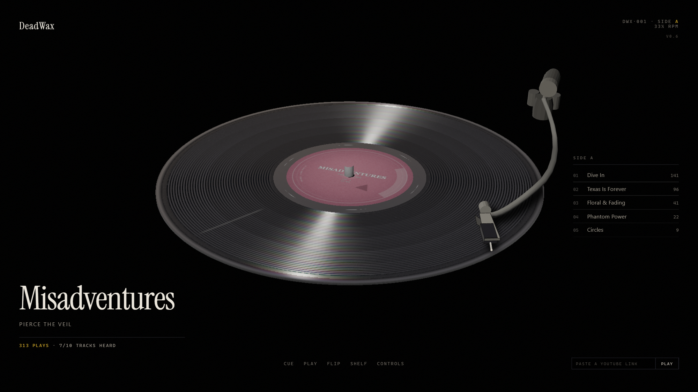
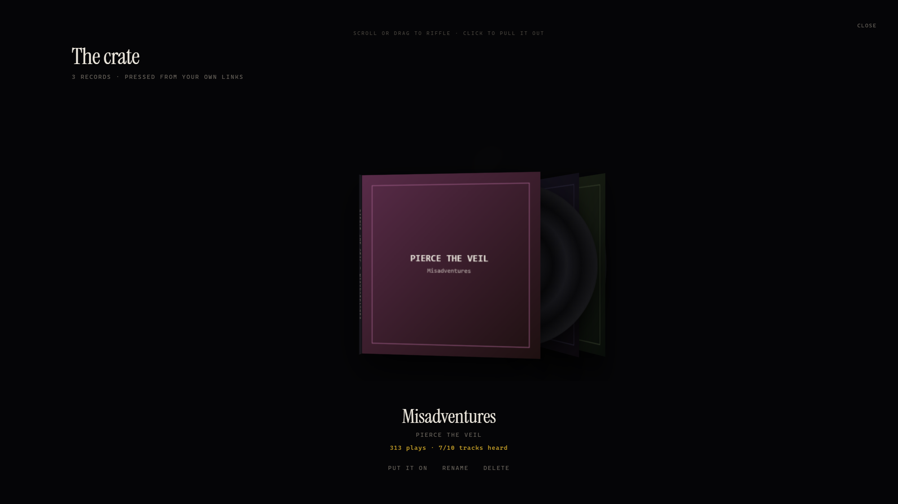

# DeadWax

A vinyl record viewer that wears where you played it, driven by your own listening history.

Live demo: [codedrichy.github.io/DeadWax](https://codedrichy.github.io/DeadWax/)



## What it does

A real record degrades along the grooves a stylus has crossed most. Play one track to death and that band goes milky while the rest of the disc stays black. DeadWax renders that.

- Bands are laid out by track duration and shaded by play count on a log curve. A track played 141 times and one played 9 times do not look alike.
- Drop in a Spotify extended-history export, a Spotify `StreamingHistory*.json`, an Apple Music CSV, or a Google Takeout `watch-history.json`. Plays count at 30 seconds, Spotify's own stream threshold. Files are parsed in the page and never leave your machine.
- Or paste a YouTube link. It looks the track up, presses a record and plays it. Dragging the tonearm seeks the video, and scrubbing the video moves the needle.
- Records stand in a crate you can scroll, drag or arrow through.



The flip is a rigid-body turn of the record, and the face swaps at the measured edge-on angle (-33.5 degrees at the default rake). The pressing sits about 0.7 mm off centre. A side holds 22 minutes of music, as a 12 inch record at 33 1/3 does.

## Status

A working web prototype in one HTML file. The plan is a desktop app that watches what you play and presses the record as you listen. That app does not exist yet. The rendering is checked by the scripts in `scripts/verify/`. The sound and feel have no automated check.

## Stack

Plain HTML, WebGL and JavaScript. Node for the local server and test scripts, Playwright for the checks.

## Run it

Open `index.html`, or serve it locally:

```
npm install
npm run serve     # http://127.0.0.1:8484
```

## Privacy

The shipped build stores your crate in `localStorage` only. There is no backend, no analytics and no account. `deadwax-data.js` is a personal listening history and is gitignored.

## License

See the LICENSE file. Its text is a proprietary notice: all rights reserved, no license granted, and it forbids copying, modifying, redistributing, forking, or using the work as training data. Viewing the repository grants no rights. SPDX: `LicenseRef-All-Rights-Reserved`.

Instrument Serif (SIL Open Font License 1.1) is bundled under its own terms. The record icon derives from a third-party stock illustration, and album art shown at runtime belongs to its rights holders.
